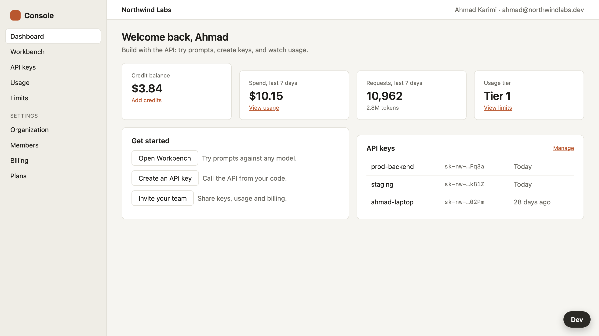
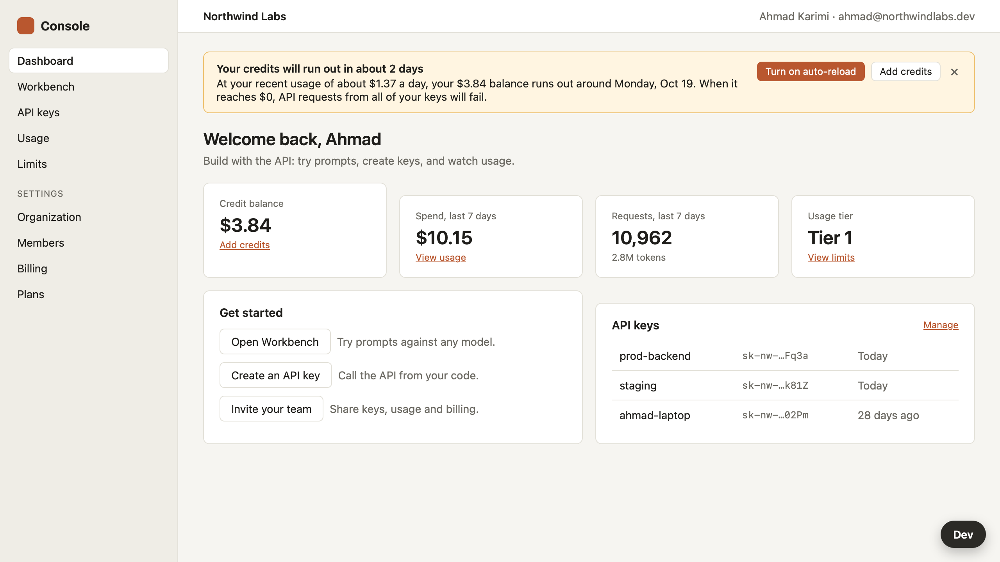
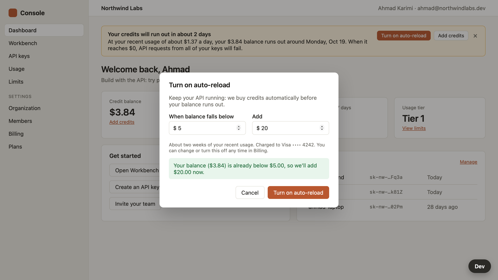
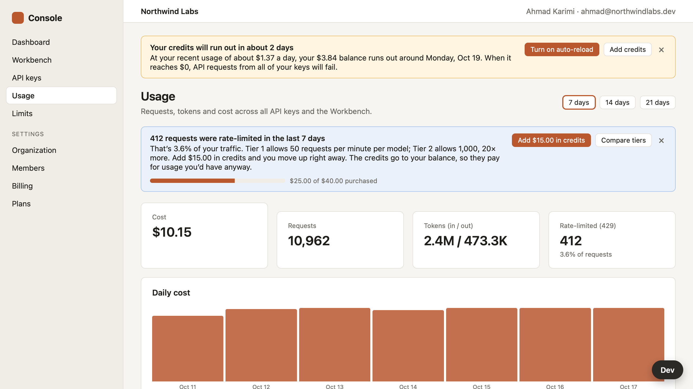
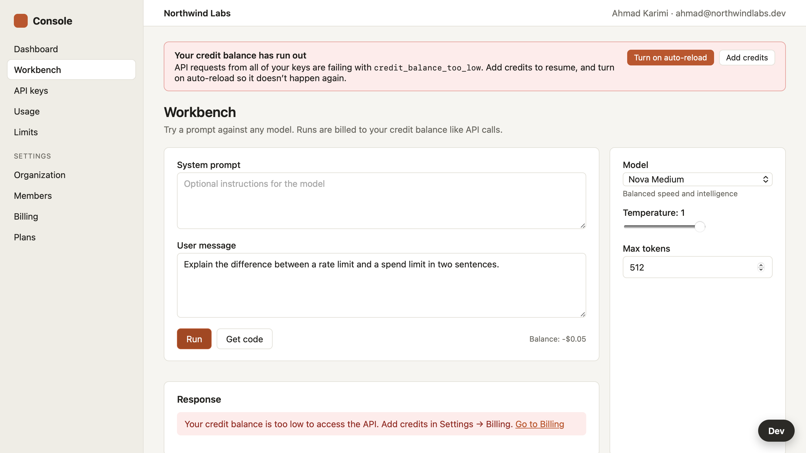
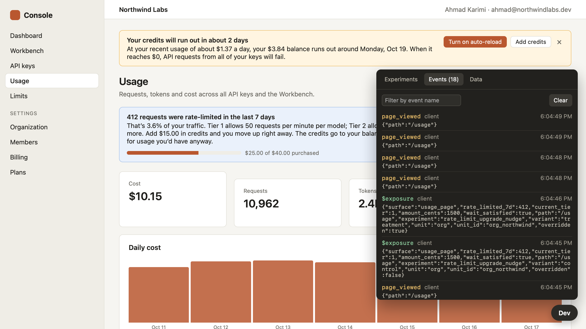

# Console Growth: Instrumented A/B Experiments in a Developer Console

## Codebase Stats

| Metric | Value |
|--------|-------|
| Total SLOC | 4,913 |
| Source Files | 74 |
| .js | 2,076 |
| .jsx | 1,994 |
| .md | 615 |
| .css | 155 |
| .json | 61 |

## Overview

A small but working slice of **Console**, the developer console for an LLM API: try models in the Workbench, manage API keys, watch usage and limits, and pay with prepaid credits. It is seeded with one account, Ahmad at Northwind Labs, and a fictitious product-wide metrics snapshot.

The project practices the **growth engineering take-home** format:
1. Read the product and the data, and find the highest-leverage growth opportunities.
2. Propose one large and one small experiment, with sizing and a hypothesis.
3. Ship both as A/B experiments: deterministic assignment, exposure logged where the user actually meets the difference, and conversion events behind the primary metric.
4. Write a readout: what shipped, how to demo it, how the metrics are computed, and how you'd roll it out.

This is a reconstruction written for this repository. The app, seed data and [METRICS.md](./METRICS.md) are original and fictitious, and they are not a copy of any real assessment's starter code.

**The worked answer** is in [EXPERIMENTS.md](./EXPERIMENTS.md). It builds two experiments:

| Experiment | Size | What the treatment does | Primary metric |
|------------|------|-------------------------|----------------|
| `credit_runway_autoreload` | Large | A banner on every page when prepaid credits will run out within 7 days at recent spend, with one-click auto-reload sized to that spend | Share of exposed orgs that run out within 14 days |
| `rate_limit_upgrade_nudge` | Small | The Usage page explains the 429s and offers the exact credit purchase that unlocks the next tier (20× the limit) | Share of exposed orgs that move up a tier within 14 days |

To practice the exercise yourself, start from the bare starter and don't read EXPERIMENTS.md first. See [CLAUDE.md → Practice mode](./CLAUDE.md#practice-mode).

## Screenshots

| | |
|---|---|
|  |  |
| Dashboard as it is today (control) | `credit_runway_autoreload` treatment: 2 days of credit left |
|  |  |
| One-click auto-reload, sized to recent spend | `rate_limit_upgrade_nudge` treatment on the Usage page |
|  |  |
| After the balance runs out: undismissable, Workbench returns 402 | Dev toolbar: live event stream with `$exposure` |

## The Practice Brief

You've joined the growth team for Console. Find the best growth opportunities in the product, explain why they matter, and ship two of them as properly instrumented experiments. Aim for about two hours.

1. **Explore and propose** (EXPERIMENTS.md §1–3). Propose two experiments, one large and one small. Size means expected impact, not engineering effort: a large one moves a top-line growth metric; a small one is a real but modest win. For each, give the idea, the problem it solves and the evidence in the product or METRICS.md, and a hypothesis naming the metric that would show it.
2. **Build both** as A/B experiments. If one is too big, ship a deliberately scoped first slice and write down what you cut. For each:
   - Register it in `server/experiments.config.js`. The control is today's behavior, unchanged.
   - Read the variant with `useExperiment()` on the client or `getAssignment()` on the server.
   - Log exposure when the user actually encounters the difference.
   - `track()` the events behind the primary metric, including at least one conversion event with useful properties.
   - Make sure both variants work and can be flipped from the Dev toolbar.
   - Keep the rest of the app working (Workbench, keys, billing), write reviewable code, and include tests.
3. **Read out** (EXPERIMENTS.md §4). Cover:
   - Which two ideas you chose and why, and what you shipped vs. cut
   - How to demo each one (key and variant)
   - How the primary and guardrail metrics are computed from your events
   - How you'd roll each one out, and what you'd do with one more week
   - Anything you changed in the framework or seed data, and why

**Out of scope:** sign-up, login and onboarding, real payments, real model calls, pixel-perfect design, deployment.

## Running It

Everything is in memory: no Docker, database or external services, so the Infrastructure Options section of other projects' READMEs doesn't apply.

```bash
cd console-growth
npm install          # also installs client/ dependencies
npm run dev          # API on :3001 + Vite on :3000 with hot reload → http://localhost:3000
```

| Command | What it does |
|---------|--------------|
| `npm run dev` | Frees ports 3000/3001 (only if this project holds them), then starts the API and Vite |
| `npm test` | Server tests (mocha + supertest), then client tests (vitest + Testing Library) |
| `npm run readout` | Per-arm metrics from `data/events.ndjson` (add `-- --include-overrides` to count Dev toolbar traffic) |
| `npm start` | Builds the client and serves everything from :3000 |
| `npm run stop` | Frees ports 3000/3001 |
| `npm run doctor` | Checks Node, installs missing dependencies, and prints the server's load error if it has one |

**Dev toolbar** (bottom right):
- **Experiments:** force a variant. Overrides are sent with every API request too.
- **Events:** the live analytics stream.
- **Data:** reset to the seed, or simulate a day of API traffic, which fast-forwards to auto-reload or depletion.

Assignment is a hash of experiment key and org or user id. Northwind Labs lands in control for both experiments, so force treatment to see them.

## Project Map

| Path | What it is |
|------|------------|
| [METRICS.md](./METRICS.md) | Fictitious growth snapshot: funnel, weekly volumes, segments, surface CTRs, support mix, instrumentation gaps |
| [EXPERIMENTS.md](./EXPERIMENTS.md) | The worked answer: opportunities, both proposals, readout |
| `server/experiments.config.js` | Experiment registry (key, unit, variants, weights, kill switch) |
| `server/lib/experiments.js` | Deterministic assignment, overrides, `logExposure()` |
| `server/lib/analytics.js` | Server-side `track()`: memory, `data/events.ndjson`, live stream |
| `server/lib/billing.js`, `runway.js` | Credits, auto-reload, tiers, depletion; runway forecast and the at-risk rule |
| `server/lib/readout.js` | Metric definitions as code: population, windows, per-arm rates and sums |
| `server/routes/*` | REST endpoints: org, keys, workbench (mock model), usage and limits, billing, experiments, events, dev |
| `server/seed.js` | The account: Build plan, Tier 1, $3.84 left, 3 weeks of growing usage, 412 recent 429s |
| `client/src/lib/experiments.jsx` | `useExperiment()`; its header comment explains where exposure belongs |
| `client/src/lib/instrumentation.js` | `track(event, props)` |
| `client/src/experiments/*` | The two experiments' UI and their tests |
| `client/src/components/DevToolbar.jsx` | Dev panel |
| `test/*.spec.js` | API smoke tests, framework, runway, growth events, readout |

## Further Reading

- [architecture.md](./architecture.md): how the experiment framework and the two experiments are designed, and what changes at production scale
- [CLAUDE.md](./CLAUDE.md): how this was built, decisions, and practice mode
- [ROADMAP entry 9, Experimentation Platform](../ROADMAP.md#9-experimentation-platform): the system design version of the same machinery
